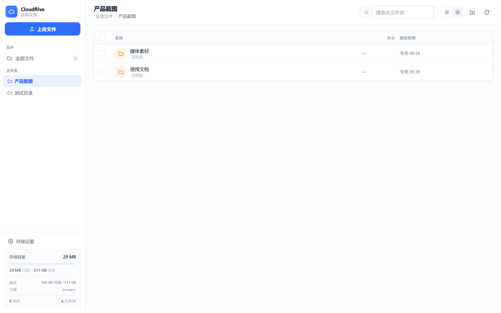
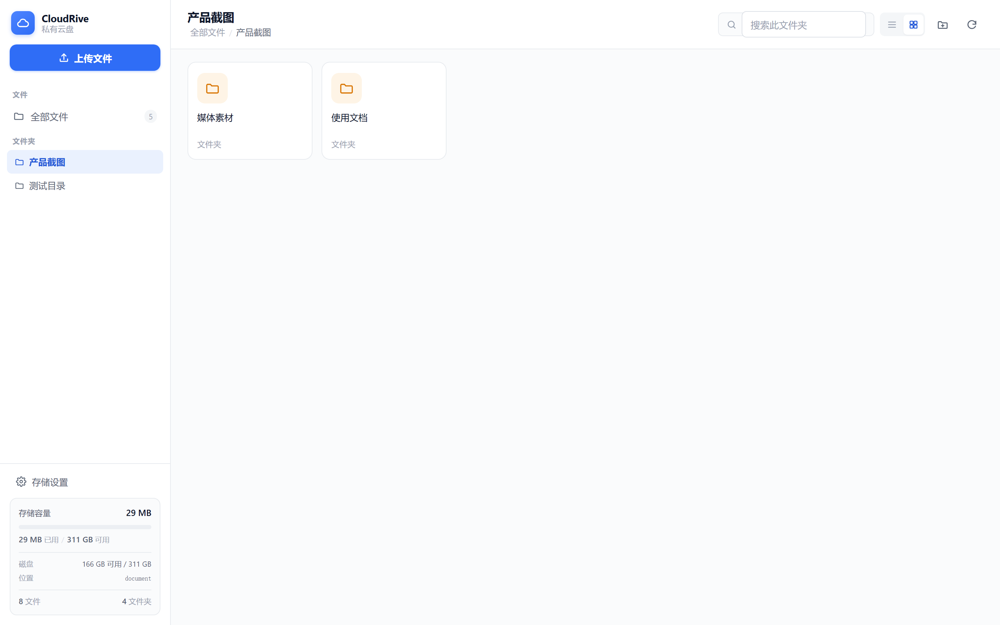
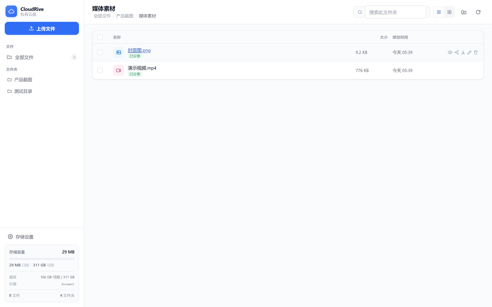
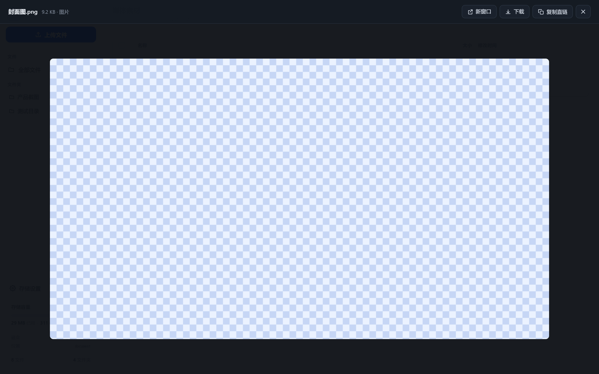
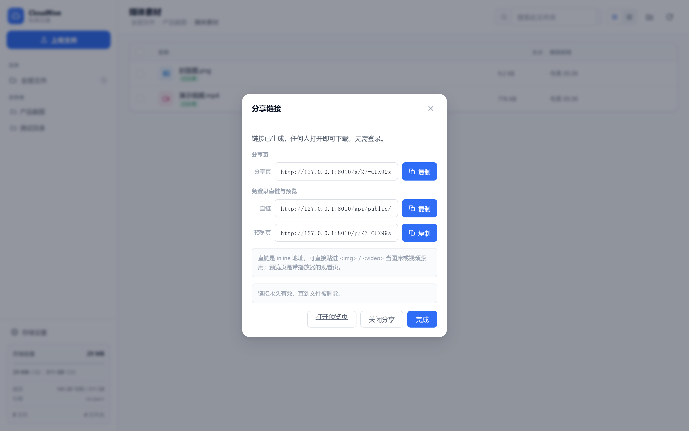
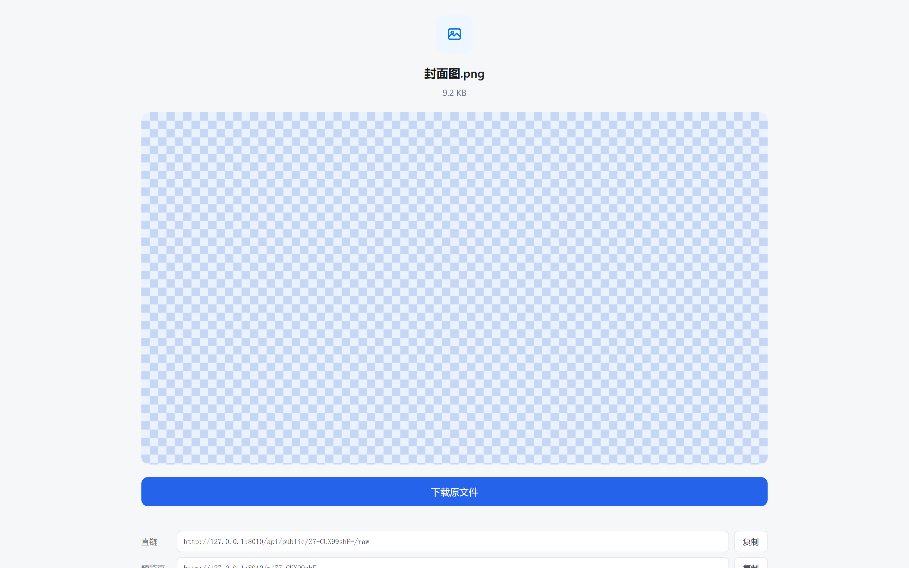
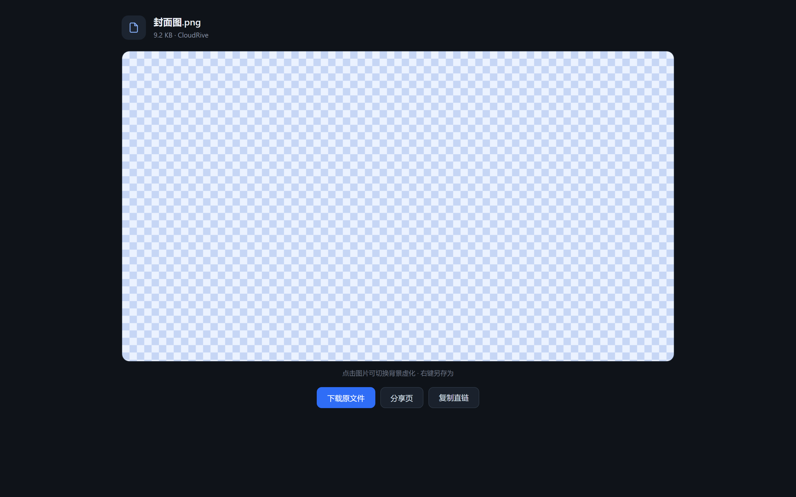
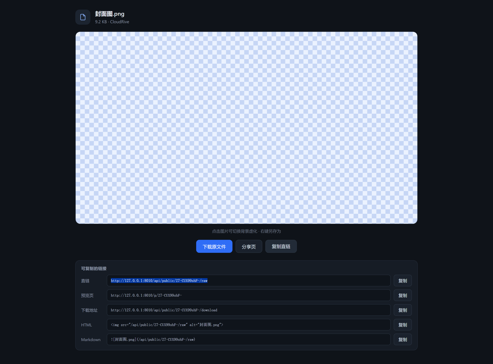
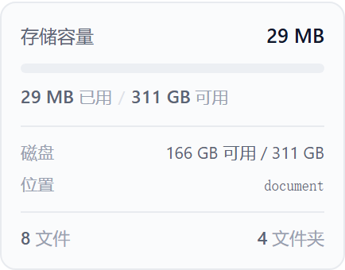

# CloudRive 云端存储

基于 FastAPI 的私有云盘。核心能力是**大文件不限速传输**、**在线预览**、**免登录分享**，可以当作图床与视频仓库直接使用。



## 目录

- [核心能力](#核心能力)
- [界面一览](#界面一览)
- [快速开始](#快速开始)
- [部署](#部署)
- [配置项](#配置项)
- [访问控制](#访问控制)
- [在线预览](#在线预览)
- [图床与视频源用法](#图床与视频源用法)
- [存储配置](#存储配置)
- [项目结构](#项目结构)
- [设计要点](#设计要点)
- [常见问题](#常见问题)

## 核心能力

| 能力 | 说明 |
|---|---|
| 大文件上传 | 分片并发上传，失败自动重试，GB 级无压力 |
| 不限速传输 | Nginx 关闭全部缓冲直通转发；S3 模式下字节完全不经过服务器 |
| 在线预览 | 图片点开就看、视频点开就播（**可拖进度条**），另支持音频 / PDF / 文本 |
| 图床直链 | `/api/public/{slug}/raw` 为 inline 地址，可直接贴进 `` / `<video>` |
| 分享链接 | `/s/{slug}` 免登录打开，**永久有效**直到文件删除 |
| 7天登录会话 | 登录后 7 天过期需重新验证；**分享链接不受影响** |
| 文件夹 | 无限层级，重命名 O(1)（存储路径与文件名解耦） |
| 批量操作 | 多选后批量下载 / 移动 / 重命名 / 删除 |
| 文件夹下载 | 流式 ZIP 打包（ZIP64，支持数 TB），边压边下发 |
| 容量显示 | 实时显示占用，**数据来自真实磁盘**，可设配额 |
| 存储后端 | 本地磁盘 或 S3 / MinIO，配置一行切换 |
| 存储路径可改 | 网页「存储设置」中随时修改，**立即生效无需重启** |
| 零构建前端 | 原生 JS 单页，无 Node 工具链，改完刷新即可 |

## 界面一览

### 主面板

列表与网格两种视图，支持搜索、多选、批量操作。侧边栏实时显示容量与磁盘信息。




文件行悬停会出现操作按钮，图片与视频额外多一个**眼睛图标**用于直接预览：



### 在线预览

图片全屏查看，点击可切换背景虚化（纯色图在白底上能看清边缘）：



视频使用浏览器播放器，**支持拖动进度条**——靠服务端的 HTTP Range 实现：


预览层顶部可以直接「复制直链」「在新窗口打开」「下载原文件」，按 `Esc` 关闭。

### 分享

每个文件可生成三个免登录地址：**分享页**（内嵌预览）、**直链**（inline，可贴进 HTML）、**预览页**（带播放器的观看页）：



### 免登录页面

分享页直接内嵌图片、视频、音频、PDF 与文本渲染：



预览页提供观看体验，并给出现成的 HTML / Markdown 引用代码：



<details>
<summary>展开引用代码区</summary>



</details>

## 快速开始

### 环境要求

| 组件 | 要求 | 说明 |
|---|---|---|
| Python | 3.11 或更高 | Windows / macOS / Linux 均可 |
| 磁盘 | 按需 | 默认存到项目下的 `document` 目录 |
| 数据库 | 无需安装 | 默认 SQLite，开箱即用 |
| Nginx | 可选 | 需要不限速或 HTTPS 时才用 |

无需数据库、无需 Node、无需构建步骤。

### 方式一：双击启动（Windows，推荐）

- **`start.bat`** —— 双击即可，纯英文输出，无编码问题
- **`start.ps1`** —— PowerShell 版，中文输出。右键「使用 PowerShell 运行」

两种脚本会自动创建虚拟环境、安装依赖、启动服务，然后打开 `http://127.0.0.1:8000`。
首次运行需联网下载依赖，约 1-2 分钟；之后启动是秒开。

> 运行后**不要关闭那个命令行窗口**，关掉窗口服务就停了。需要停止时在窗口里按 `Ctrl+C`。

**双击没反应？** 右键 →「以管理员身份运行」。最常见的原因是没装 Python，或装的是精简版（不含 venv 模块）。

### 方式二：手动启动

```bash
# 1. 创建虚拟环境
python -m venv venv

# 2. 激活
venv\Scripts\activate          # Windows
source venv/bin/activate       # macOS / Linux

# 3. 安装依赖
pip install -r requirements.txt

# 4. 启动
python -m uvicorn app.main:app --host 127.0.0.1 --port 8000
```

浏览器打开 `http://127.0.0.1:8000`。

> **不要加 `--reload` 参数。** 它会在代码变动时重启进程，导致进行中的分片上传失败。

### 方式三：Docker

```bash
cp .env.example .env      # 按需修改
docker compose up -d --build
```

访问 `http://<服务器IP>`（80 端口）。

## 部署

### 目录结构

部署时需要保留的目录：

```
data/          SQLite 数据库与运行时配置（必须持久化）
document/      默认存储目录（可改，也可挂载到别处）
deploy/        Nginx 配置与证书
```

**备份只需备份 `data/` 和存储目录。**

### Linux 裸机部署

```bash
# 1. 安装依赖
sudo apt update && sudo apt install -y python3-venv nginx

# 2. 拉代码并建虚拟环境
cd /opt/cloudrive
python3 -m venv venv
venv/bin/pip install -r requirements.txt

# 3. 配置
cp .env.example .env
vi .env
```

`.env` 至少要改这三项：

```bash
PUBLIC_BASE_URL=https://pan.example.com     # 用于拼接分享链接
PANEL_PASSWORD=你的强密码
AUTH_SECRET=$(openssl rand -base64 48)      # 固定密钥，重启不掉登录
```

```bash
# 4. 用 systemd 托管
sudo vi /etc/systemd/system/cloudrive.service
```

```ini
[Unit]
Description=CloudRive
After=network.target

[Service]
Type=simple
User=www-data
WorkingDirectory=/opt/cloudrive
Environment="PATH=/opt/cloudrive/venv/bin"
ExecStart=/opt/cloudrive/venv/bin/uvicorn app.main:app \
          --host 127.0.0.1 --port 8000 --proxy-headers
Restart=always

[Install]
WantedBy=multi-user.target
```

```bash
sudo systemctl daemon-reload
sudo systemctl enable --now cloudrive
sudo systemctl status cloudrive
```

注意 `--host 127.0.0.1`：只监听本机，公网流量全部经 Nginx 转发。

### 配置 Nginx

仓库里的 `deploy/nginx.conf` 已经配好关键项，直接用：

```bash
sudo cp deploy/nginx.conf /etc/nginx/conf.d/cloudrive.conf
sudo vi /etc/nginx/conf.d/cloudrive.conf   # 改 server_name 与证书路径
sudo nginx -t && sudo systemctl reload nginx
```

### HTTPS 证书

仓库**不包含任何证书或私钥**（私钥进 git 等于公开泄露，即使删除也能从历史里翻出来）。

需要 HTTPS 时用仓库里的脚本在本地生成自签证书：

```bash
# Linux / macOS
./deploy/certs/generate-cert.sh                        # 默认 3650 天
./deploy/certs/generate-cert.sh 365 pan.example.com     # 指定天数与 CN
```

```powershell
# Windows PowerShell
.\deploy\certs\generate-cert.ps1
.\deploy\certs\generate-cert.ps1 -Days 365 -HostName pan.example.com
```

生成的 `server.crt` / `server.key` 已被 `.gitignore` 排除，不会误提交。
脚本会自动带上 `Subject Alternative Name`，否则 Chrome / Firefox 会报
`NET::ERR_CERT_COMMON_NAME_INVALID`。

**公网部署请换成 Let's Encrypt：**

```bash
sudo apt install -y certbot python3-certbot-nginx
sudo certbot --nginx -d pan.example.com
# certbot 会自动改写 nginx 配置
sudo systemctl reload nginx
```

> 如果你之前把自签证书提交过，那个私钥已经泄露。
> 请在服务器上重新生成一套，并到 GitHub 仓库设置里清除历史中的大文件。

### 部署到公网时必须改的两处

**一、Cookie 加上 `secure`。** 否则会话 Cookie 会走明文 HTTP：

```python
# app/api/auth_api.py
secure=True,     # 原为 False
```

**二、Nginx 强制 HTTPS。** `deploy/nginx.conf` 里已有：

```nginx
server {
    listen 80;
    server_name _;
    return 301 https://$host$request_uri;
}
```

### Docker 部署说明

`docker-compose.yml` 起三个服务：

| 服务 | 作用 | 对外端口 |
|---|---|---|
| `app` | FastAPI 应用 | 仅 `127.0.0.1:8000`（不直接暴露） |
| `nginx` | 反向代理，关闭缓冲实现不限速 | `80` / `443` |
| `minio` | S3 兼容对象存储（可选） | `127.0.0.1:9000` / `9001` |

数据都在命名卷里：

```bash
docker volume ls | grep cloudrive     # 查看卷名
```

`app` 只监听 `127.0.0.1` 是**刻意的**——公网只能从 Nginx 进，避免绕过 HTTPS 与缓冲配置。

备份：

```bash
docker run --rm \
  -v cloudrive_appdata:/data:ro \
  -v cloudrive_miniodata:/minio:ro \
  -v $(pwd):/backup alpine \
  tar czf /backup/cloudrive-$(date +%F).tar.gz -C /data . \
  && tar czf /backup/minio-$(date +%F).tar.gz -C /minio .
```

### 不限速的关键配置

Nginx 默认会缓冲请求体和响应，导致大文件传输明显变慢。以下配置**必须保留**：

```nginx
client_max_body_size 0;          # 不限制上传体积
proxy_request_buffering off;     # 请求体直通，不落磁盘
proxy_buffering         off;     # 响应直通
proxy_read_timeout     3600s;    # 长连接超时（ZIP 打包下载耗时长）
gzip off;                        # 压缩会拖慢大文件并占用 CPU
```

已在 `deploy/nginx.conf` 中配好。

**若用 MinIO 直传**，需要给 MinIO 配同样的直通规则，否则 S3 侧会成为瓶颈。

### 换端口

8000 被占用时，改启动命令的 `--port` 即可：

```bash
python -m uvicorn app.main:app --host 127.0.0.1 --port 8010
```

`start.bat` / `start.ps1` 里的端口也可以直接改。

## 配置项

全部配置在 `.env`，复制 `.env.example` 后按需修改。

### 基础

| 变量 | 默认值 | 说明 |
|---|---|---|
| `PUBLIC_BASE_URL` | `http://127.0.0.1:8000` | 对外地址，用于拼接分享链接。**公网部署必填** |
| `STORAGE_BACKEND` | `local` | `local` 或 `s3` |
| `LOCAL_STORAGE_DIR` | `./document` | 本地存储目录，不存在会自动创建 |
| `DATABASE_URL` | `sqlite:///./data/cloudrive.db` | 数据库连接串 |
| `CORS_ORIGINS` | `*` | 前后端同域时无需改动 |

### 上传

| 变量 | 默认值 | 说明 |
|---|---|---|
| `MULTIPART_CHUNK_SIZE` | `33554432`（32 MiB） | 分片大小。**必须 ≥ 5 MiB**（S3 协议硬性要求） |
| `DIRECT_UPLOAD_THRESHOLD` | `8388608`（8 MiB） | 小于此值走单请求直传，更大走分片 |

分片大小影响上传并行度与内存占用：调大减少请求数，但单片失败要重传更多。

### 存储配额

| 变量 | 默认值 | 说明 |
|---|---|---|
| `STORAGE_QUOTA` | 空 | 云盘容量上限。留空 = 用磁盘真实剩余空间 |

支持 `10GB` / `500MB` / `2TB` / `1.5GB`，也可直接写字节数 `10737418240`。
设置后进度条按配额计算，超过 85% 变黄、95% 变红。

### 访问控制

| 变量 | 默认值 | 说明 |
|---|---|---|
| `PANEL_PASSWORD` | 空 | 面板密码。**留空 = 不需要密码** |
| `AUTH_SECRET` | 空 | 令牌签名密钥。留空则运行时随机生成，**重启后需重新登录** |
| `SESSION_MAX_AGE` | `604800`（7 天） | 登录会话有效期（秒） |
| `MAX_LOGIN_ATTEMPTS` | `5` | 连续输错几次后临时锁定 |
| `LOCKOUT_SECONDS` | `300` | 锁定时长（秒） |

### S3 / MinIO

仅当 `STORAGE_BACKEND=s3` 时需要：

| 变量 | 说明 |
|---|---|
| `S3_ENDPOINT` | 形如 `https://s3.example.com`，可走 Nginx 反代 |
| `S3_BUCKET` | 桶名 |
| `S3_ACCESS_KEY` / `S3_SECRET_KEY` | 访问密钥 |
| `S3_REGION` | 默认 `us-east-1` |

### 动态配置

以下几项**在网页「存储设置」中改**，改完立即生效，不需要重启，也不写死在 `.env`：

- 存储后端（local / S3）
- 存储路径
- 分片大小与直传阈值

持久化在 `data/runtime_settings.json`。

## 访问控制

### 两套独立的鉴权

理解这一点很重要：

| 机制 | 作用范围 | 有效期 |
|---|---|---|
| **登录会话** | 面板与受保护 API | **7 天**，到期重新验证密码 |
| **分享链接** | 特定文件的预览与下载 | **永久**，直到文件被删除 |

两者互不影响：会话过期后，你已经发出去的分享链接**依然有效**。

### 路由划分

| 路径 | 是否需要登录 |
|---|---|
| `/` 面板页面 | 需要（未登录自动跳 `/login`） |
| `/login` 登录页 | 免登录 |
| `/api/nodes/*` 文件管理 | 需要 |
| `/api/files/*` 上传 | 需要 |
| `/api/files/{id}/preview` 面板内预览 | 需要 |
| `/api/settings/*` 存储设置 | 需要 |
| `/api/capacity` 容量查询 | 需要 |
| `/s/{slug}` 分享页 | 免登录 |
| `/p/{slug}` 公开预览页 | 免登录 |
| `/api/public/{slug}/download` | 免登录 |
| `/api/public/{slug}/raw` 直链 | 免登录 |

免登录路由**只对 GET / HEAD 生效**，写操作一律要登录。

### 7 天登录会话

登录后 7 天会话即过期，到期必须重新输入密码。

| 时机 | 行为 |
|---|---|
| 登录成功后 | 侧边栏「退出登录」按钮上显示剩余时长 |
| 剩余不足 1 天 | 弹一次提醒，避免正在上传时被踢出 |
| 会话到期 | 自动跳回登录页，提示"会话已过期（有效期 7 天）" |
| 任意请求收到 401 | 立即清本地令牌并跳登录页 |

调整时长改 `.env` 的 `SESSION_MAX_AGE`：

```bash
SESSION_MAX_AGE=259200   # 3 天
SESSION_MAX_AGE=604800   # 7 天（默认）
SESSION_MAX_AGE=2592000  # 30 天
```

> 勾选「保持登录状态」也是 7 天，不延长到更长 —— 这是刻意设计，
> 确保任何情况下最多 7 天都要重新验证一次密码。

**服务端为准**：令牌里带绝对到期时间戳，每次请求校验签名与时间，
改前端时间或本地存储都绕不过。前端倒计时只是提示，不是安全边界。

### 安全设计

- **无状态令牌**：HMAC-SHA256 签名，不存 session，多进程与重启均有效
- **恒定时间比较**：`hmac.compare_digest` 防时序侧信道
- **防暴力破解**：按 IP 记录失败次数，超限临时锁定
- **分享链接不可伪造**：必须凭 `share_slug`，服务端校验分享是否有效。
  **猜 `node_id` 无法绕过**——面板内预览与下载接口都在登录保护之下
- **密码不落代码**：只在 `.env` 配置

> 公网部署务必启用 HTTPS，否则密码在传输中是明文。

## 在线预览

### 支持的类型

| 类型 | 预览方式 |
|---|---|
| 图片 | 全屏查看，点击切换背景虚化 |
| 视频 | 浏览器播放器，**支持拖动进度条** |
| 音频 | 播放器 |
| PDF | 内嵌阅读器 |
| 文本 / 代码 | 渲染显示，超长自动截断 |

其他类型（如 ZIP、PSD）会提示不支持预览，直接走下载。

扩展名白名单在 `app/services/preview.py` 与 `frontend/app.js` 各有一份，
**新增格式要同时改两处**，否则会出现「前端说是视频、后端按二进制下载」。

### 面板内预览的四种入口

- **点击文件名** —— 图片/视频/文本直接打开预览，其他类型照旧下载
- **悬停行点眼睛图标** —— 专门开预览
- **网格视图卡片左上角** —— hover 出现预览按钮
- **批量操作栏「预览」** —— 选中多项时打开第一个可预览项

### 技术要点

**Range 支持。** 视频拖进度条依赖 `Range: bytes=` 请求。服务端返回
`206 Partial Content` 与正确的 `Content-Range`，支持三种写法：

```
Range: bytes=0-1023      闭区间
Range: bytes=1024-       开放式（到文件末尾）
Range: bytes=-1024       后缀（最后 1024 字节）
```

越界或格式非法自动回落全量 `200`。local 与 S3 两个后端都实现了区间读取。

**inline 语义。** `Content-Disposition: attachment` 会让 `` / `<video>`
直接变成下载框，所以直链必须发 `inline`。中文文件名按 RFC 5987
用 `filename*=UTF-8''` 编码。

**MIME 兜底。** 部分历史文件存的是 `application/octet-stream`，
浏览器会拒绝渲染。按扩展名回退到正确类型（`.mp4` → `video/mp4`）。

**S3 零带宽。** S3 模式下跳 presigned inline URL，文件字节不经过应用服务器。

## 图床与视频源用法

开启分享后，每个文件都有一条 **inline 直链**：

```
/api/public/{slug}/raw
```

因为是 inline 而非 attachment，可以直接贴进任何第三方页面：

```html

<video src="https://pan.example.com/api/public/{slug}/raw" controls></video>
<a href="https://pan.example.com/api/public/{slug}/raw">下载原文件</a>
```

Markdown 也可以：

```markdown

```

获取直链的两种方式：

1. 面板里点分享按钮，弹窗中有「直链」一栏可一键复制
2. 预览层顶部点「复制直链」（会自动开启分享）

> **安全提醒**：直链是免登录的，**任何拿到链接的人都能访问该文件**。
> 这是当图床用的必然代价。如果内容不适合公开，请放在带鉴权的
> 反向代理后面，或改用私有桶 + 签名 URL。

## 存储配置

### 存储路径

**默认存到项目目录下的 `document` 文件夹**，可在网页中随时修改：

- 点击左下角 **存储设置**
- 可直接输入路径，或点「浏览」逐级选择目录
- 支持相对路径（`./document`）与绝对路径（Linux `/data/files`、Windows `D:\files`）
- 目录不存在会自动创建
- **修改后立即生效，无需重启服务**

每个文件会记录上传时使用的存储目录，因此**切换存储路径后，历史文件仍可正常下载和删除**。

### 容量显示

侧边栏数据全部来自真实设备：



- **已用**：数据库汇总的文件字节数，随上传/删除实时变化
- **可用**：默认取磁盘真实剩余空间；配置 `STORAGE_QUOTA` 后取配额上限
- **磁盘**：存储目录所在分区的真实容量

刷新时机：

| 时机 | 行为 |
|---|---|
| 上传完成 / 删除 | 立即刷新（跳过缓存） |
| 修改存储路径 | 立即刷新 |
| 平时 | 每 15 秒轮询 |
| 页面切到后台 | 暂停轮询 |

服务端带 8 秒缓存，避免频繁读盘。

### S3 / MinIO

```bash
STORAGE_BACKEND=s3
S3_ENDPOINT=https://你的域名
S3_BUCKET=cloudrive
S3_ACCESS_KEY=xxx
S3_SECRET_KEY=xxx
```

浏览器**直连对象存储**上传下载，服务器只签发凭证，不经流量。

## 项目结构

```
cloudrive/
├── app/
│   ├── main.py                 应用入口，路由注册
│   ├── core/
│   │   ├── config.py           配置（环境变量）
│   │   ├── auth.py             令牌签发与校验、7 天会话
│   │   ├── middleware.py       登录拦截 + 免登录白名单
│   │   └── db.py               数据库连接
│   ├── models/node.py          统一节点模型（文件与文件夹同表）
│   ├── schemas/                请求响应模型
│   ├── services/
│   │   ├── storage.py          存储抽象层（local / S3 双后端）
│   │   ├── node_service.py     目录树、重命名、移动、容量统计
│   │   ├── preview.py          预览类型判定、Range 解析、inline 输出
│   │   └── share_service.py    分享链接生成
│   └── api/                    路由：节点、上传、下载、分享、预览
├── frontend/                   单页面板（原生 JS，无构建步骤）
├── deploy/
│   ├── nginx.conf              反向代理（不限速关键）
│   └── certs/
│       ├── generate-cert.sh    自签证书生成（Linux/macOS）
│       └── generate-cert.ps1   自签证书生成（Windows）
├── docs/images/                README 截图
├── .env.example                配置模板（无敏感值，可提交）
├── data/                       SQLite 与运行时配置（需持久化，不入库）
├── document/                   默认存储目录（不入库）
├── Dockerfile
├── docker-compose.yml
├── start.bat / start.ps1       Windows 一键启动
└── requirements.txt
```

### 安全相关约定

| 约定 | 原因 |
|---|---|
| `.env` 不入库，只有 `.env.example` | `.env` 含真实密码与 `AUTH_SECRET` |
| 证书不入库，只提交生成脚本 | 私钥进 git 等于公开泄露 |
| `data/` `document/` 不入库 | 用户文件与运行时状态 |
| 分享链接凭 `share_slug` | 猜 `node_id` 无法绕过密码 |

## 设计要点

**存储路径与文件名解耦。** 文件实际存储在 `f/{node_id}`，文件名只存在数据库。
因此重命名是纯数据库操作，即使对接 S3（其"移动"实为 copy + delete）也不会搬运字节。

**统一节点模型。** 文件与文件夹共用一张表，递归查询、移动、删除逻辑统一，无需类型分支。

**递归 CTE。** 子树查询用一条 SQL 完成，避免 N+1。

**ZIP64 流式打包。** 文件夹打包落临时文件后逐块下发，内存占用恒定，突破 4GB 限制。

**字节不经过应用服务器。** S3 模式跳 presigned URL，local 模式配合 Nginx 直通，
应用只负责签发凭证与维护元数据，因此不受单机带宽限制。

## 常见问题

**端口 8000 被占用**
改 `--port` 参数即可，见[换端口](#换端口)。也可以在 `.env` 里给
`PUBLIC_BASE_URL` 同步改成新端口。

**服务重启后需要重新登录**
`.env` 里 `AUTH_SECRET` 留空了。填一个固定值：
`openssl rand -base64 48`。

**上传大文件失败 / 中断**
- 确认 Nginx 的 `client_max_body_size 0` 与 `proxy_request_buffering off` 都在
- 确认没加 `--reload` 参数
- 调大 `MULTIPART_CHUNK_SIZE` 试试

**视频无法拖动进度条**
说明 Range 请求没走到应用层。检查是否被 CDN 或其他代理缓存/改写了。
直连应用验证：`curl -H "Range: bytes=0-99" -I <直链地址>`，应返回 `206`。

**预览显示成下载框**
浏览器拿到了 `Content-Disposition: attachment`。检查反向代理有没有改写这个响应头。

**图片能预览但显示不出来**
多为 MIME 不对。用 `curl -I <直链地址>` 看 `Content-Type` 是不是
`application/octet-stream`，是的话说明历史数据缺 MIME，扩展名回退没生效。

**容量显示不准**
已用数据来自数据库汇总。如果手动删过存储目录里的文件，数据库还记着，
删一次对应文件让两边一致即可。

**想在公网用但不想让人改设置**
不设置 `PANEL_PASSWORD` 就是无密码状态，务必设置。
另外 `/api/settings/*` 只在登录保护内，无密码时任何人都能改存储路径。
